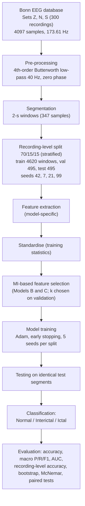
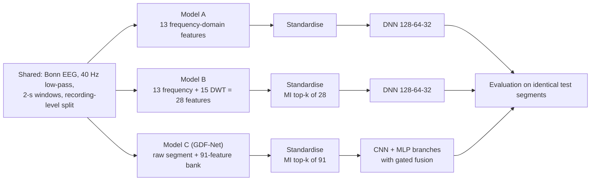
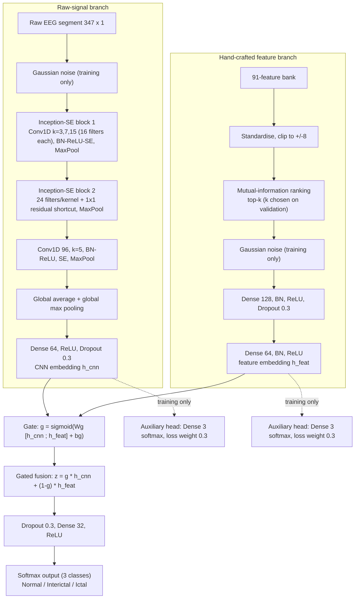

# GDF-Net: Gated Fusion of a Raw-Signal Convolutional Branch and Wavelet–Spectral Features for Three-Class EEG Classification Under Recording-Level Evaluation

**Authors:** Harinii S, Krithikalakshmi R
**Paper:** [`EEG_Classification_Using_DL.pdf`](EEG_Classification_Using_DL.pdf)

> This README summarises the research paper above. All figures in `figures/` are the **original figures extracted from the paper PDF** (Figs. 1–9), and all numbers are the values reported in the paper. The Mermaid flowcharts are simplified Markdown representations that complement, not replace, the original figures.

---

## Table of Contents
1. [Project Overview](#1-project-overview)
2. [Objectives](#2-objectives)
3. [Dataset Description](#3-dataset-description)
4. [Experimental Workflow](#4-experimental-workflow)
5. [Proposed Model Architecture (GDF-Net)](#5-proposed-model-architecture-gdf-net)
6. [Data Preprocessing](#6-data-preprocessing)
7. [Feature Extraction and Feature Selection](#7-feature-extraction-and-feature-selection)
8. [Model Training and Classification](#8-model-training-and-classification)
9. [Evaluation Metrics](#9-evaluation-metrics)
10. [Results and Performance Comparison](#10-results-and-performance-comparison)
11. [Key Findings](#11-key-findings)
12. [Limitations](#12-limitations)
13. [Future Work](#13-future-work)
14. [Repository Structure](#14-repository-structure)
15. [References](#15-references)


---

## 1. Project Overview

Electroencephalography (EEG) records brain activity non-invasively with high temporal resolution. This study classifies EEG segments from the Bonn database into three brain-state classes: **Normal**, **Interictal** and **Ictal** (seizure activity).

Three pipelines are compared under identical conditions (same recording-level partitions, same 4,620 training windows, same training schedule and same test segments):

| Model | Description |
|---|---|
| **Model A** | DNN using 13 frequency-domain features |
| **Model B** | DNN using mutual-information (MI)-selected features from 13 frequency-domain + 15 DWT descriptors (28 total) |
| **Model C (GDF-Net)** | Gated dual-branch network: multi-scale squeeze-and-excitation (SE) CNN on the raw segment + MI-selected features from a 91-feature bank (spectral, wavelet-packet, DWT, nonlinear) |

The paper stresses that reported EEG accuracy depends on class definitions and data partitioning, so all models are retrained under one recording-level protocol and only results from these consistent experiments are reported.

## 2. Objectives

1. Build two feature-based DNN baselines (Models A and B) for three-class EEG classification and re-check them under a recording-level protocol.
2. Design **GDF-Net**, a gated dual-branch network fusing a raw-signal multi-scale SE-CNN with MI-selected spectral, wavelet-packet, DWT and nonlinear features, with the number of retained features chosen only on the validation set.
3. Compare the three models using accuracy, macro precision, recall, F1-score, class-wise metrics, recording-level accuracy and four repeated recording-level splits.
4. Measure the contribution of each GDF-Net component by ablation and by comparison with classical classifiers trained on the same selected features.
5. Evaluate differences with statistical tests and a recording-level bootstrap interval, and discuss dataset and design limitations.

## 3. Dataset Description

The public **Bonn EEG database** is used: five subsets A–E (folders Z, O, N, F, S), each with 100 single-channel segments of 23.6 s (4,097 samples at 173.61 Hz), band-pass filtered at 0.53–40 Hz.

| Subset (folder) | Recording type |
|---|---|
| A (Z) | Surface EEG, healthy volunteers, eyes open/closed |
| B (O) | Surface EEG, healthy volunteers (**excluded**) |
| C (N) | Intracranial, seizure-free, recorded outside the epileptogenic zone |
| D (F) | Intracranial, seizure-free, recorded inside the epileptogenic zone (**excluded**) |
| E (S) | Intracranial, seizure activity |

**Class definitions used in this study (100 recordings per class, 300 total):**

| Class | Bonn set |
|---|---|
| Normal | Set A (Z) |
| Interictal | Set C (N) |
| Ictal | Set E (S) |

**Recording-level split** (class-stratified, 70/15/15): 210 training, 45 validation and 45 test recordings (70/15/15 per class). The primary seed is 42, with additional seeds 7, 21 and 99. Because subject IDs are unavailable, subject-level independence cannot be ensured.

## 4. Experimental Workflow

All three models share the dataset, preprocessing, partitioning and evaluation; they differ in input representation and classifier.



*Simplified Markdown representation of the workflow in Section 3 of the paper; see the original Fig. 1 below.*


### Model-comparison flowchart



*Simplified Markdown representation of the right-hand side of Fig. 1.*

## 5. Proposed Model Architecture (GDF-Net)

GDF-Net (Model C) processes each 2-second segment through two branches and fuses their 64-dimensional embeddings with a learned sigmoid gate.

- **Raw-signal branch:** the 347-sample segment receives Gaussian noise during training and passes through an Inception-style block (parallel 1-D convolutions, kernels 3, 7, 15, 16 filters each, batch normalisation, ReLU, SE attention with reduction ratio 4, max pooling). A second block uses 24 filters per kernel with a 1×1 residual shortcut, followed by a 96-filter, kernel-5 convolution with SE attention, global average/max pooling and a 64-unit dense layer, giving `h_cnn`.
- **Feature branch:** the 91-feature bank is standardised (clipped to ±8), ranked by mutual information and reduced to the top k features (k chosen on validation). After training-only Gaussian noise, dense layers of 128 and 64 units (batch normalisation, ReLU, dropout) give `h_feat`.
- **Gated fusion:** `g = σ(W_g [h_cnn ; h_feat] + b_g)` and `z = g ⊙ h_cnn + (1 − g) ⊙ h_feat`. The fused vector passes through dropout, a 32-unit dense layer and softmax.
- **Auxiliary heads:** softmax heads on `h_cnn` and `h_feat` supervise each branch during training (deep supervision) and are not used at inference. Total loss: `L = L_main + 0.3 L_cnn + 0.3 L_feat`.
- With k = 15 on the primary split, GDF-Net has **110,951** trainable parameters.



*Simplified Markdown representation of Fig. 3 (solid arrows: forward path; dashed arrows: training only).*


## 6. Data Preprocessing

- Each recording is filtered with a zero-phase, 4th-order Butterworth low-pass filter at 40 Hz.
- Recordings are split into 2-second segments (347 samples); each recording produces 11 non-overlapping segments.
- **Validation and test sets:** 495 segments each (165 per class).
- **Training set:** 4,620 windows = 11 non-overlapping + 11 half-shifted windows (shifted by 173 samples) per training recording.
- Validation and test recordings are never used during training. All scaling parameters are computed from training windows only; the raw branch is normalised by the training-window standard deviation.
- The validation set is used for early stopping, learning-rate scheduling and selecting the number of features.

## 7. Feature Extraction and Feature Selection

### Model A: 13 frequency-domain features
Welch's method (256-sample windows) estimates the power spectral density; band powers use trapezoidal integration.

| Group | Definition | Count |
|---|---|---|
| Band power | Absolute power in δ (0.5–4 Hz), θ (4–8 Hz), α (8–13 Hz), β (13–30 Hz) | 4 |
| Total band power | Sum of the four band powers | 1 |
| Dominant frequency | PSD maximum between 0.5 and 30 Hz | 1 |
| Relative band power | Each band power / total band power | 4 |
| Band ratios | θ/α, β/α, δ/α | 3 |
| **Total** | | **13** |

### Model B: 15 DWT features (db4, four levels)
The db4 wavelet gives five sub-bands (D1–D4, A4), each described by energy, relative energy and Shannon entropy (15 features).

| Sub-band | Range (Hz) | Approximate EEG rhythm |
|---|---|---|
| D1 | 43.4 – 86.8 | High gamma and noise |
| D2 | 21.7 – 43.4 | Beta and low gamma |
| D3 | 10.9 – 21.7 | Alpha and beta |
| D4 | 5.4 – 10.9 | Theta and alpha |
| A4 | 0 – 5.4 | Delta and low theta |

Energy: `E_j = Σ c_{j,k}²`; relative energy: `RE_j = E_j / Σ_i E_i`; Shannon entropy: `H_j = − Σ p_{j,k} log p_{j,k}` with `p_{j,k} = c_{j,k}² / E_j`.

.

### Model C: 91-feature bank

| Group | Features | Count |
|---|---|---|
| Time domain / Hjorth | Mean, log-variance, amplitude range, max, min, peak-to-RMS ratio, skewness, kurtosis, Hjorth mobility and complexity, zero-crossing rate, log line length | 12 |
| Spectral | Log and relative power in δ, θ, α, β, γ (30–40 Hz); log total power; ratios θ/α, β/α, δ/α, (δ+θ)/(α+β); spectral entropy; 95% spectral edge frequency; median frequency; spectral centroid; dominant frequency | 20 |
| Nonlinear | Permutation entropy (order 3, delay 1), Higuchi fractal dimension (kmax = 8), Petrosian fractal dimension | 3 |
| Wavelet packet | db4, level 4, 16 nodes: relative energy and normalised Shannon entropy per node | 32 |
| DWT | db4, level 5, sub-bands A5 and D5–D1: log energy, relative energy, normalised entropy, mean absolute coefficient | 24 |
| **Total** | | **91** |

### Mutual-information feature selection
MI between each feature and the class label is estimated on **training data only** using the Kraskov nearest-neighbour estimator (three neighbours, scikit-learn). The number of retained features k is chosen from validation accuracy of an Extra-Trees probe (200 trees):

- Model B: k ∈ {12, 16, 20, 24, 28}
- Model C: k ∈ {15, 25, 35, 50, 70, 91}
- Model A: all 13 features (no selection)

Ties favour smaller k, and the subset is fixed before test evaluation.

## 8. Model Training and Classification

| Setting | Models A and B | Model C (GDF-Net) |
|---|---|---|
| Input | 13 (A) or k of 28 (B) standardised features | Raw 347-sample segment and k of 91 selected features |
| Training windows | 4,620 | 4,620 (11 non-overlapping + 11 half-shifted per training recording) |
| Validation / test | 495 / 495 segments | 495 / 495 segments (same) |
| Parameters | 12,227 (A); 13,635 (B, k = 24) | 110,951 (k = 15, primary split) |
| Optimiser | Adam, lr 2×10⁻³, batch 64, ≤ 120 epochs, LR halved on plateau (min 10⁻⁵) | Identical |
| Early stopping | Validation loss, patience 18 | Identical |
| Loss | Cross-entropy, label smoothing 0.05 | Same, plus auxiliary heads (weight 0.3 each) |
| Regularisation | Dropout 0.3 | Dropout 0.3, batch normalisation, input noise, shift/scale augmentation of raw branch |
| Ensemble | Five seeds per split | Five seeds per split (same seeds) |

- **Models A and B:** fully connected DNN with 128, 64 and 32 ReLU units, dropout 0.3 after the two hidden layers, three-class softmax output.
- **GDF-Net augmentation:** raw inputs are shifted by up to ±25 samples and amplitude-scaled between 0.9 and 1.1.
- Experiments ran on TensorFlow using a Google Colab GPU. The architecture and hyperparameters were fixed before testing, and the test set was not used during tuning.


## 9. Evaluation Metrics

- Accuracy, per-class precision, recall and F1-score, and macro one-vs-rest AUC.
- Macro precision / recall / F1 average the class-wise scores equally over the three classes.
- **Recording-level accuracy:** the 11 segment probabilities per test recording are averaged and the class with the highest mean probability is assigned (45 test recordings, 15 per class).
- Primary-split paired decisions: exact McNemar tests. 95% bootstrap intervals resample the 45 test recordings 5,000 times.
- Across four splits: paired t-tests and exact sign tests. The paper notes the p-values are descriptive because splits overlap and segments within a recording are correlated.

## 10. Results and Performance Comparison

### Primary split (495 segments, 45 recordings) — paper Table 5

| Model | Acc. (%) | Macro precision | Macro recall | Macro F1 | AUC (OvR) | Record. acc. (%) |
|---|---|---|---|---|---|---|
| Model A | 93.33 | 0.9349 | 0.9333 | 0.9321 | 0.9734 | 95.56 |
| Model B | 92.93 | 0.9288 | 0.9293 | 0.9290 | 0.9888 | 95.56 |
| **Model C (GDF-Net)** | **96.77** | **0.9685** | **0.9677** | **0.9675** | **0.9954** | **97.78** |
| Model A (ensemble) | 93.54 | 0.9367 | 0.9354 | 0.9342 | 0.9733 | 95.56 |
| Model B (ensemble) | 92.93 | 0.9292 | 0.9293 | 0.9289 | 0.9882 | 95.56 |
| **Model C (ensemble)** | **95.96** | **0.9598** | **0.9596** | **0.9594** | **0.9923** | **97.78** |

On this split, ensembling did not improve Model C.

### Four recording-level splits (mean ± SD) — paper Table 6

| Model | Accuracy (%) | Macro F1 | Recording acc. (%) |
|---|---|---|---|
| Model A | 91.72 ± 1.97 | 0.9174 ± 0.0188 | 95.56 ± 3.14 |
| Model B | 93.18 ± 0.53 | 0.9321 ± 0.0054 | 97.78 ± 1.81 |
| **Model C (GDF-Net)** | **97.02 ± 1.58** | **0.9702 ± 0.0158** | **98.89 ± 1.28** |
| Model A (ensemble) | 91.87 ± 1.88 | 0.9189 ± 0.0178 | 95.56 ± 3.14 |
| Model B (ensemble) | 93.54 ± 1.35 | 0.9355 ± 0.0134 | 97.78 ± 2.57 |
| **Model C (ensemble)** | **97.37 ± 1.38** | **0.9737 ± 0.0139** | **98.89 ± 1.28** |
| SVM-RBF (selected features) | 95.96 ± 1.92 | 0.9596 ± 0.0191 | 97.78 ± 1.81 |
| Extra-Trees (selected features) | 96.21 ± 1.88 | 0.9620 ± 0.0190 | 98.33 ± 2.13 |
| Gradient boosting (selected features) | 96.06 ± 1.64 | 0.9605 ± 0.0167 | 98.33 ± 2.13 |

### Per-split test accuracy (%) — paper Table 7

| Split (seed) | A single | B single | C single | A ens. | B ens. | C ens. |
|---|---|---|---|---|---|---|
| 1 (42) | 93.33 | 92.93 | 96.77 | 93.54 | 92.93 | 95.96 |
| 2 (7) | 92.73 | 93.13 | 98.99 | 92.93 | 95.56 | 99.19 |
| 3 (21) | 91.92 | 93.94 | 95.15 | 91.72 | 92.73 | 96.77 |
| 4 (99) | 88.89 | 92.73 | 97.17 | 89.29 | 92.93 | 97.58 |


### Class-wise performance and confusion matrices

Ictal recall was 0.9939 for all models (164 of 165 segments). **Interictal was the hardest class**: ensemble recall was 0.8424 (A), 0.8667 (B) and 0.9152 (C). The most common error was Interictal predicted as Normal (15 segments for A, 18 for B, 11 for C).

| Model (ensemble) | Class | Precision | Recall | F1 |
|---|---|---|---|---|
| Model A | Normal | 0.9143 | 0.9697 | 0.9412 |
| | Interictal | 0.9586 | 0.8424 | 0.8968 |
| | Ictal | 0.9371 | 0.9939 | 0.9647 |
| Model B | Normal | 0.8947 | 0.9273 | 0.9107 |
| | Interictal | 0.9167 | 0.8667 | 0.8910 |
| | Ictal | 0.9762 | 0.9939 | 0.9850 |
| Model C (GDF-Net) | Normal | 0.9357 | 0.9697 | 0.9524 |
| | Interictal | 0.9618 | 0.9152 | 0.9379 |
| | Ictal | 0.9820 | 0.9939 | 0.9880 |


### ROC curves and learned representation


The mean gate value on the CNN embedding was 0.521 (Normal), 0.552 (Interictal) and 0.654 (Ictal), indicating that both branches contribute and the CNN branch is weighted more for Ictal.

### Ablation study — paper Table 9

| Variant | Primary split acc. (%) | Accuracy (%), four splits | Macro F1, four splits |
|---|---|---|---|
| Model A, single network | 93.33 | 91.72 ± 1.97 | 0.9174 ± 0.0188 |
| Model B, single network | 92.93 | 93.18 ± 0.53 | 0.9321 ± 0.0054 |
| SVM-RBF (selected features) | 95.35 | 95.96 ± 1.92 | 0.9596 ± 0.0191 |
| Extra-Trees (selected features) | 94.55 | 96.21 ± 1.88 | 0.9620 ± 0.0190 |
| Gradient boosting (selected features) | 94.34 | 96.06 ± 1.64 | 0.9605 ± 0.0167 |
| Feature branch only (MLP) | 95.56 | 96.62 ± 1.23 | 0.9661 ± 0.0125 |
| Raw-signal branch only (multi-scale SE-CNN) | 94.95 | 95.15 ± 1.99 | 0.9514 ± 0.0198 |
| Dual branch, concatenation, no auxiliary heads | 95.76 | 96.82 ± 1.50 | 0.9681 ± 0.0150 |
| Dual branch, gated fusion, no auxiliary heads | 94.95 | 96.36 ± 1.91 | 0.9637 ± 0.0191 |
| **GDF-Net, single network** | **96.77** | **97.02 ± 1.58** | **0.9702 ± 0.0158** |
| **GDF-Net, five-network ensemble** | **95.96** | **97.37 ± 1.38** | **0.9737 ± 0.0139** |

### Statistical comparison (summary of paper Section 4.5)

- On the primary split, McNemar p-values for single runs: C vs A = 1.51×10⁻³, C vs B = 3.11×10⁻⁴; B vs A = 0.864 (no difference).
- Bootstrap (5,000 resamples of 45 recordings): C − A = +3.43 points (95% CI +0.61 to +7.68); C − B = +3.84 (95% CI +0.81 to +8.08). For ensembles the intervals include zero (C − A: −0.20 to +6.26; C − B: −0.00 to +6.87).
- Across four splits, C won every comparison (4/4). Paired t-tests were below 0.05 except against SVM-RBF (p ≈ 0.10). The minimum two-sided exact sign-test p-value is 0.125, which is not significant. The paper advises interpreting these results with caution.

## 11. Key Findings

- Across four splits, single-network accuracy was **91.72 ± 1.97%** (A), **93.18 ± 0.53%** (B) and **97.02 ± 1.58%** (GDF-Net). Five-network ensembles reached 91.87 ± 1.88%, 93.54 ± 1.35% and 97.37 ± 1.38%. GDF-Net led on every split.
- GDF-Net improved ensemble Interictal recall to 0.9152, versus 0.8424 (A) and 0.8667 (B).
- **Most of the gain comes from the richer selected features and raw-waveform learning**, not from fusion: the feature-only network reached 96.62% and the raw-only network 95.15%.
- Gated fusion added only about **0.2–0.4 percentage points** over feature-only / concatenation, within split variability. Gated fusion without auxiliary heads underperformed concatenation, so the superiority of gating or auxiliary supervision is **not established**.
- The GDF-Net ensemble exceeded classical classifiers on the same selected features by 1.2–1.4 points, small relative to the 1.6–1.9 point variability across splits.
- Model B's improvement over A (1.46 points single, 1.67 ensemble on average) was not statistically distinguishable from zero.
- The 15 features selected for GDF-Net on the primary split included nine DWT descriptors, five amplitude/time features and log beta power; no wavelet-packet or nonlinear feature was chosen, so their advantage is not shown.
- Published Bonn accuracies are not directly comparable because studies use different class combinations and validation protocols; two-class tasks are easier than three-class tasks that include Interictal activity.

## 12. Limitations

As acknowledged by the authors:

- **Small dataset:** few recordings and single-channel signals; 45 test recordings per split create substantial uncertainty.
- **Recording-level, not subject-level independence:** no subject IDs are available, so the same individual may appear in both training and test sets. Results show generalisation to recordings, not necessarily to new patients.
- **Recording-modality differences:** Normal data are surface EEG, while Interictal and Ictal data are intracranial. The models may exploit amplitude and high-frequency energy differences caused by acquisition, making the classes look more separable than they are.
- **Uneven regularisation:** Model C also uses batch normalisation, input noise and raw-branch augmentation, which were not tested separately.
- **Unstable feature selection:** chosen k varied across splits (15–91 for C, 12–24 for B), and probe accuracy was nearly flat.
- **Limited ablations and tuning:** ablations and classical classifiers use one model per split; the architecture was not searched systematically and baselines were not tuned.
- **Statistical analysis:** few, overlapping splits make p-values descriptive only.
- **No external validation** on different protocols, patients or electrode montages.

> The results apply to the Bonn EEG database under this protocol and should not be generalised to clinical EEG.

## 13. Future Work

Per the paper: repeated cross-validation over more recording-level splits with dependence-aware significance tests; subject-independent evaluation on datasets with patient identifiers; stable feature selection (e.g., bootstrap-aggregated MI rankings) and validation-set architecture tuning; evaluation on larger multi-patient, multi-channel datasets and on data where all classes share the same recording modality; comparison with further deep EEG architectures and analysis of the learned gate for interpretability.

## 14. Repository Structure

```text
EEG-Classification-Using-DL/
├── README.md
├── EEG_Classification_Using_DL.ipynb
└── figures/
    ├── fig1_experimental_pipeline.png
    ├── fig2_dwt_filter_bank.png
    ├── fig3_gdfnet_architecture.png
    ├── fig4_accuracy_comparison.png
    ├── fig5_confusion_matrices.png
    ├── fig6_ensemble_vs_classical.png
    ├── fig7_top20_mutual_information.png
    ├── fig8_roc_and_tsne.png
    └── fig9_training_curves.png
```

This repository contains the paper and its figures only. The paper does not provide source code, and none is claimed here.

## 15. References

Selected references as cited in the paper (see the PDF for the full list of 37):

1. Andrzejak RG, Lehnertz K, Mormann F, Rieke C, David P, Elger CE (2001) Indications of nonlinear deterministic and finite-dimensional structures in time series of brain electrical activity: dependence on recording region and brain state. *Phys Rev E* 64(6):061907. https://doi.org/10.1103/PhysRevE.64.061907
2. Wong S, Simmons A, Rivera-Villicana J, et al. (2023) EEG datasets for seizure detection and prediction—a review. *Epilepsia Open* 8(2):252–267. https://doi.org/10.1002/epi4.12704
3. Tsipouras MG (2019) Spectral information of EEG signals with respect to epilepsy classification. *EURASIP J Adv Signal Process* 2019:10. https://doi.org/10.1186/s13634-019-0606-8
4. Aliyu I, Lim CG (2020) Selection of optimal wavelet features for epileptic EEG signal classification with LSTM. *Neural Comput Appl*. https://doi.org/10.1007/s00521-020-05666-0
5. Kraskov A, Stögbauer H, Grassberger P (2004) Estimating mutual information. *Phys Rev E* 69(6):066138
6. Hu J, Shen L, Sun G (2018) Squeeze-and-excitation networks. *Proc IEEE CVPR*, pp 7132–7141
7. Szegedy C, et al. (2015) Going deeper with convolutions. *Proc IEEE CVPR*, pp 1–9
8. Arevalo J, Solorio T, Montes-y-Gómez M, González FA (2017) Gated multimodal units for information fusion. arXiv:1702.01992
9. Lee C-Y, Xie S, Gallagher P, Zhang Z, Tu Z (2015) Deeply-supervised nets. *Proc AISTATS*, pp 562–570
