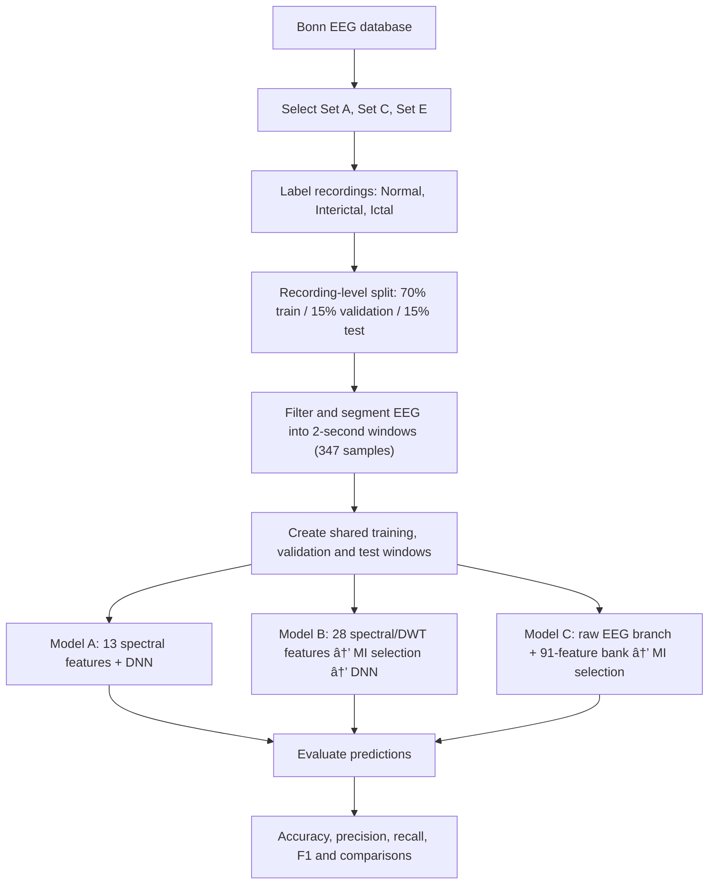
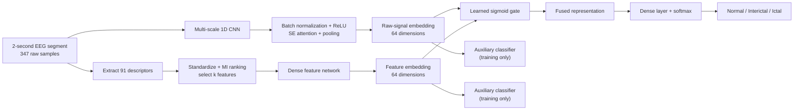

# EEG Classification Using Deep Learning

## GDF-Net: Gated Fusion of a Raw-Signal Convolutional Branch and Wavelet–Spectral Features

**Authors:** HARINII S, KRITHIKALAKSHMI R  
**Task:** Three-class EEG classification — **Normal, Interictal, and Ictal**  
**Dataset:** Bonn EEG database

This repository README summarizes the method and results described in the accompanying research PDF. The images in `figures/` are page captures from the original PDF so that the diagrams, flowcharts, and result figures remain visible on GitHub.

## Table of Contents
- [Project Overview](#project-overview)
- [Dataset](#dataset)
- [Experimental Flowchart](#experimental-flowchart)
- [Three Compared Models](#three-compared-models)
- [GDF-Net Architecture](#gdf-net-architecture)
- [Training and Evaluation](#training-and-evaluation)
- [Results](#results)
- [Limitations](#limitations)
- [Repository Structure](#repository-structure)
- [Reference](#reference)

## Project Overview

The study compares three pipelines for classifying Bonn EEG recordings into Normal, Interictal, and Ictal classes:

- **Model A:** DNN using 13 frequency-domain features.
- **Model B:** DNN using mutual-information (MI)-selected features from 13 frequency-domain and 15 discrete wavelet transform (DWT) descriptors.
- **Model C — GDF-Net:** gated dual-branch network that combines a multi-scale CNN operating on raw EEG segments with a network operating on MI-selected hand-crafted features from a 91-feature bank.

All three models use the same recording-level partitions, training windows, training schedule, and test segments.

## Dataset

The study uses three subsets of the Bonn EEG database:

| Class | Bonn subset | Recordings |
|---|---|---:|
| Normal | Set A (Z) | 100 |
| Interictal | Set C (N) | 100 |
| Ictal | Set E (S) | 100 |
| **Total** | | **300** |

Each recording contains 4,097 samples over 23.6 seconds, sampled at 173.61 Hz. Sets B (O) and D (F) are excluded from this experiment.

### Recording-level split

- Training: 70% — 210 recordings
- Validation: 15% — 45 recordings
- Testing: 15% — 45 recordings
- Primary random seed: 42; additional seeds: 7, 21, and 99

The split is performed at the original-recording level so segments from the same recording are not distributed across train, validation, and test sets.

## Experimental Flowchart



### Original experimental pipeline figure


## Three Compared Models

### Model A — Frequency-domain DNN

1. Extract 13 frequency-domain descriptors from each segment.
2. Standardize the features.
3. Pass the feature vector through a DNN with hidden layers of 128, 64, and 32 ReLU units.
4. Use a three-class softmax output.

### Model B — MI-selected spectral/DWT DNN

1. Extract 13 frequency-domain and 15 DWT descriptors (28 total).
2. Rank features using mutual information calculated on training data.
3. Choose the number of retained features using validation accuracy.
4. Feed selected standardized features to the DNN classifier.

### Model C — GDF-Net

GDF-Net uses two parallel branches:

- **Raw-signal branch:** multi-scale 1D convolutions, batch normalization, ReLU, squeeze-and-excitation (SE) attention, pooling, and a 64-dimensional embedding.
- **Feature branch:** MI-selected and standardized descriptors from a 91-feature bank, processed by dense layers to form a 64-dimensional embedding.
- **Gated fusion:** a learned sigmoid gate combines the two embeddings. The fused representation is classified into the three EEG classes. Auxiliary branch classifiers provide training supervision.

## GDF-Net Architecture



### Original GDF-Net architecture figure


### Feature-bank composition

| Feature group | Number of descriptors |
|---|---:|
| Time-domain / Hjorth | 12 |
| Welch spectral | 20 |
| Nonlinear | 3 |
| Level-4 db4 wavelet-packet | 32 |
| Level-5 db4-DWT | 24 |
| **Total** | **91** |

Feature selection is based on mutual information. The number of selected features is chosen using validation accuracy; the held-out test set is reserved for final evaluation.

## Training and Evaluation

- Segment duration: 2 seconds (347 samples)
- Optimizer: Adam
- Learning rate: 0.002, reduced when validation loss plateaus
- Batch size: 64
- Maximum epochs: 120
- Early stopping and best validation weights are used
- Evaluation metrics: accuracy, precision, recall, F1-score, and macro one-vs-rest AUC
- Five networks with different random seeds are averaged for ensemble results

## Results

### Accuracy summary

| Model | Primary split, single network | Four-split mean accuracy |
|---|---:|---:|
| Model A — spectral DNN | 93.33% | 91.72 ± 1.97% |
| Model B — spectral/DWT + MI + DNN | 92.93% | 93.18 ± 0.53% |
| Model C — GDF-Net | **96.77%** | **97.02 ± 1.58%** |
| GDF-Net five-network ensemble | 95.96% | **97.37 ± 1.38%** |

The reported results show that GDF-Net had the highest mean accuracy among the compared models. The study also reports that most of the improvement is associated with the richer feature representation and raw-waveform learning; the additional gain attributable to gated fusion was comparatively small.

### Original result figures from the PDF


*The figure files are page captures from the source PDF. They may include the surrounding page text as well as the original figure.*

## Limitations

- The evaluation uses the Bonn EEG database only; no external dataset validation was performed.
- Subject-independent evaluation cannot be guaranteed because subject identifiers are not available in the described protocol.
- Normal recordings are surface EEG, whereas the Interictal and Ictal recordings are intracranial; recording-modality differences may influence classification.
- The study notes that the improvement from gated fusion over simpler alternatives is small relative to split variability.
- Results should not be interpreted as evidence of clinical readiness or assumed to generalize to other EEG datasets.

## Repository Structure

```text
EEG_Classification_GitHub/
├── README.md
└── figures/
    ├── fig1_experimental_pipeline.png
    ├── fig3_gdfnet_architecture.png
    ├── fig4_model_comparison.png
    ├── fig5_confusion_matrices.png
    ├── fig6_ensemble_accuracy.png
    └── fig7_feature_gate_analysis.png
```

The image files are copied page captures from the PDF. Some captures are included as supplementary visual references; the main README flowcharts are rendered using Mermaid, which GitHub supports in Markdown.

## Reference

Andrzejak RG, Lehnertz K, Mormann F, Rieke C, David P, Elger CE (2001). *Indications of nonlinear deterministic and finite-dimensional structures in time series of brain electrical activity: dependence on recording region and brain state.*

For the complete method, tables, and bibliography, refer to the original research PDF, `EEG_Classification_Using_DL.pdf`.

---

**Note:** This repository README documents the paper. It does not itself provide the model implementation code or guarantee reproducibility without the corresponding source code and environment.

